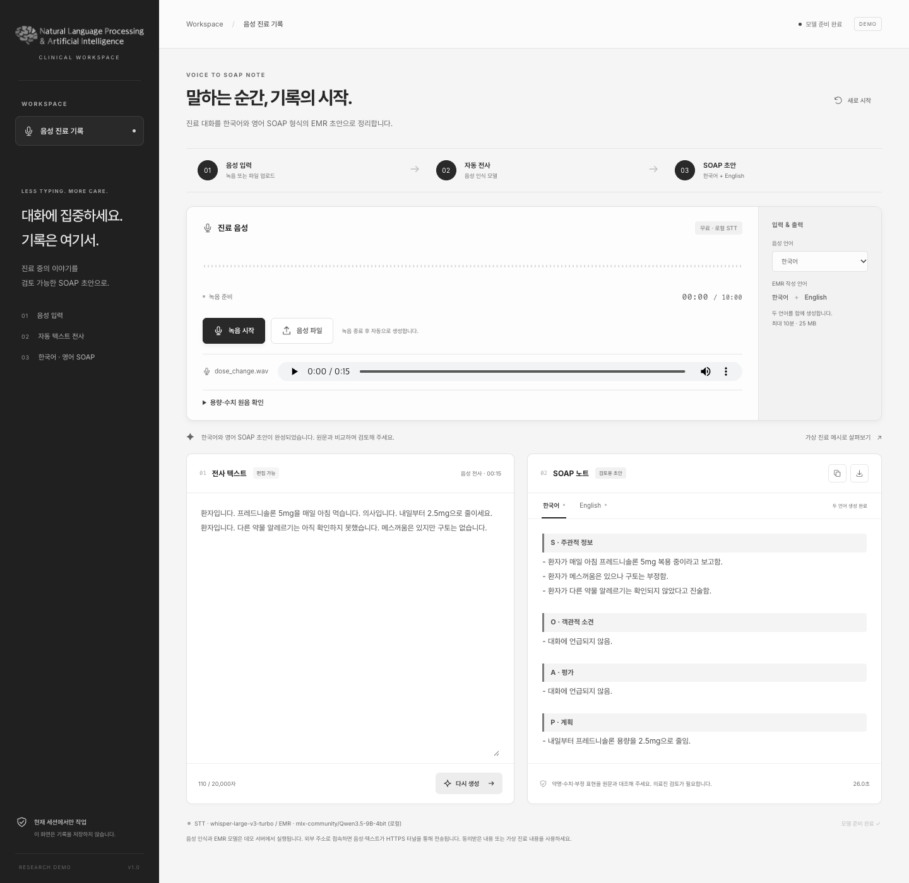
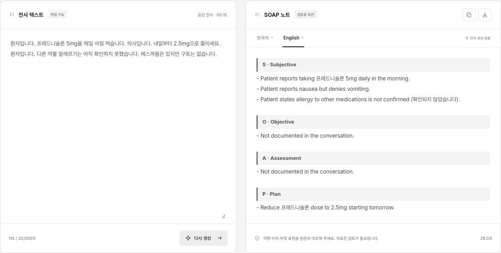

<p align="center">
  
</p>

# Voice → SOAP · 음성으로 시작하는 진료 기록

**한국어 진료 대화를 녹음하면, 전사부터 한국어·영어 SOAP 초안까지 한 화면에서.**

마이크 녹음 · 음성 파일 업로드 · 전사문 편집 · 용량 구간 재생 · 한영 노트 복사·다운로드를 지원하는 연구용 데모입니다.

**[데모 사이트 열기 ↗](https://nlp-ai-demo.mediqa-qwen-eval.workers.dev/)**

[사용 방법](#사용-방법) · [STT·EMR 모델](#sttemr-모델) · [접속 확인](#외부-접속-확인) · [로컬 실행](#로컬-실행)

> [!IMPORTANT]
> **로그인이 필요합니다.** 발표자·운영자에게 받은 계정과 비밀번호를 브라우저의 로그인 창에 입력하세요. 접속 비밀번호는 이 공개 저장소에 게시하지 않습니다.
>
> 모델은 운영자의 Mac에서 실행됩니다. Mac이 로그인된 채 깨어 있고 인터넷에 연결되어 있을 때 이용할 수 있습니다.

## 화면 미리보기



*공개 데모 주소에서 가상 한국어 진료 음원을 업로드해 생성한 실제 화면입니다. 전사문이나 생성 결과를 캡처용으로 수정하지 않았습니다. 촬영: 2026-10-16.*

<details>
<summary><strong>같은 대화의 영어 SOAP 화면 보기</strong></summary>



한국어와 영어는 한 번에 생성됩니다. **한국어 / English** 탭으로 결과를 전환합니다.

</details>

## 사용 방법

| 순서 | 화면에서 할 일 | 결과 |
| --- | --- | --- |
| **1. 접속** | [데모 주소](https://nlp-ai-demo.mediqa-qwen-eval.workers.dev/)를 열고 전달받은 접속 정보로 로그인 | 모델 상태와 작업 화면 표시 |
| **2. 음성 입력** | **녹음 시작** → 마이크 허용 → 녹음 종료, 또는 **음성 파일**로 업로드 | 전사 후 한국어·영어 SOAP를 자동 생성 |
| **3. 원문 확인** | 전사문을 읽고 **용량·수치 원음 확인**에서 해당 구간을 재생 | 용량·부정 표현·화자 정보 대조 |
| **4. 수정·검토** | 필요하면 전사문을 편집한 뒤 **한·영 SOAP 생성 / 다시 생성** 클릭 | 수정한 내용으로 두 언어 재생성 |
| **5. 결과 활용** | **한국어 / English** 탭 전환, 복사 또는 다운로드 아이콘 클릭 | 선택 언어 복사 / 두 언어를 담은 TXT 다운로드 |

**음원 없이 먼저 살펴보려면:** 화면의 **가상 진료 예시로 살펴보기**를 누르고 **한·영 SOAP 생성**을 선택하세요. 이 기능은 예시 전사문을 채우며, STT를 시험하는 기능은 아닙니다. 직접 대화 내용을 붙여 넣을 수도 있습니다.

**녹음이 안 되면:** 브라우저의 사이트 마이크 권한을 허용하고 HTTPS 주소로 접속했는지 확인하세요. 마이크가 없는 기기에서는 음성 파일 업로드를 사용하면 됩니다. 첫 생성에는 모델 로딩 시간이 추가될 수 있으며, 다른 사용자가 처리 중이면 완료 후 다시 시도하세요.

### SOAP에 담기는 내용

| 항목 | 내용 |
| --- | --- |
| **S · Subjective** | 환자가 말한 증상, 현재 복용약, 병력 등 주관적 정보 |
| **O · Objective** | 대화에 명시된 활력징후, 진찰·검사 소견 |
| **A · Assessment** | 대화에서 의료진이 명시한 평가 |
| **P · Plan** | 처방·용량 변경, 검사, 추적 관찰 등의 계획 |

대화에 없는 내용은 추측해 채우지 않도록 지시하며, 언급되지 않은 항목은 그 상태로 표시합니다. 출력은 의료진 검토가 필요한 초안입니다.

## STT·EMR 모델

```text
음성 녹음 / 파일 업로드
    ↓ PyAV: 16 kHz 모노 · Silero VAD: 음성 구간 검출
Whisper large-v3-turbo → 한국어 전사
    ↓
Qwen3.5-9B → 영어 SOAP
    ↓ 원문 + 영어 SOAP를 함께 참조
Qwen3.5-9B → 한국어 SOAP
    ↓ 숫자 검증 · SOAP 형식 · 한국어 문체 정리
한국어 / English 탭 · 복사 · TXT 다운로드
```

| 단계 | Apple Silicon 기본값 | 설정 |
| --- | --- | --- |
| STT | [mlx-community/whisper-large-v3-turbo](https://huggingface.co/mlx-community/whisper-large-v3-turbo) | MLX FP16, temperature 0, 이전 발화 문맥 비활성화 |
| 음성 전처리 | PyAV + faster-whisper의 Silero VAD | 16 kHz 모노, 최대 28초 구간, 무음 2초, 구간 여백 400ms |
| SOAP 생성 | [mlx-community/Qwen3.5-9B-4bit](https://huggingface.co/mlx-community/Qwen3.5-9B-4bit) | MLX 4bit, thinking 비활성화, greedy 생성 |
| 한영 일치 | 영어 SOAP 생성 후 원문·영어 노트로 한국어 생성 | 숫자 검증, SOAP 형식 정리, 제한적인 분류·한국어 문체 보정 |

<details>
<summary>고정 모델 버전과 다른 실행 환경</summary>

아래 기본 모델의 다운로드 revision은 코드에 고정되어 있습니다.

- MLX Whisper: `a4aaeec0636e6fef84abdcbe3544cb2bf7e9f6fb`
- MLX Qwen: `8b2b98c00a6b4d291155e4890773ca8f769aee53`
- 일반 Qwen: `c202236235762e1c871ad0ccb60c8ee5ba337b9a`

Apple Silicon 외 환경에서는 faster-whisper `large-v3`와 Transformers `Qwen/Qwen3.5-9B`를 선택합니다. CPU STT는 int8, CUDA STT는 float16을 사용합니다. 이 대체 경로의 실행 속도와 메모리 요구량은 장비에 따라 다르며, 이번 배포 확인은 Mac의 기본 MLX 경로를 대상으로 했습니다.

</details>

한국어 STT에는 일반 진료 어휘와 `확인한 뒤`를 힌트로 제공합니다. 용량·부정 표현을 정답으로 주입하거나 `귀`를 일괄적으로 `뒤`로 치환하지 않습니다. SOAP 보정은 명시적인 문장 패턴에만 적용되며 임의의 진단·용량을 만들어 채우지 않도록 설계했습니다. 단, 모델 출력의 의학적 정확성을 보장하지 않습니다.

## 외부 접속 확인

**2026-10-16 (KST)**에 고정 공개 URL을 통해 확인했습니다.

| 점검 | 확인 결과 |
| --- | --- |
| 로그인하지 않은 방문 / 잘못된 비밀번호 | `401` — 인증 필요 |
| 정상 로그인 후 화면·상태 API·CSS·JS·로고 | 모두 `200` |
| 허용되지 않은 Origin의 요청 | `403` — 요청 차단 |
| 가상 한국어 WAV 업로드 → STT → 한영 SOAP | 실제 브라우저에서 전 과정 완료, API `200` |
| 예제의 용량·부정·SOAP 분류 | 현재 5mg은 S, 내일부터 2.5mg 변경은 P에 보존. 구토 부정·알레르기 미확인 유지 |

계정·비밀번호를 전달받은 외부 이용자가 접속할 수 있는 구성입니다. 로그인 없이 사용할 수 있는 공개 서비스는 아닙니다. 이번 확인은 운영 Mac의 **공개 HTTPS 주소를 통한 브라우저·HTTP 검사**이며, 다른 실물 기기나 별도 이동통신망에서의 접속·마이크 녹음까지 시험한 것은 아닙니다. 위 예제는 개발 확인용이며 일반적인 임상 정확도를 입증하지 않습니다.

고정 주소는 Worker → VPC Service → named tunnel → Mac으로 연결됩니다. 터널 재시작 뒤에도 같은 주소를 사용하지만, Mac 종료·절전·로그아웃 중에는 사용할 수 없습니다. Cloudflare 중계망을 통해 음성·전사문·SOAP가 전달되므로 가상 진료 내용 또는 동의받은 자료를 사용하세요. 배포·자동 실행·요금 조건은 [DEMO.md](DEMO.md)를 참고하세요.

## 로컬 실행

Apple Silicon Mac에서 Python **3.13.0**으로 검증했습니다. 최초 설치와 모델 다운로드에는 인터넷 및 여러 GB의 저장 공간이 필요합니다. 준비한 모델로 로컬 추론할 때 유료 API 키는 필요하지 않습니다.

```bash
git clone https://github.com/MyoungJinKim/EMR_demo.git
cd EMR_demo
python3.13 -m venv .venv-demo
source .venv-demo/bin/activate
python -m pip install -r requirements-demo.txt
python scripts/prepare_voice_demo.py
bash scripts/run_voice_demo.sh
```

브라우저에서 <http://127.0.0.1:8765/>를 열고 모델 준비 후 음성을 녹음하거나 업로드합니다. 준비 스크립트가 출력하는 `STT_MODEL`, `STT_DEVICE`, `EMR_MODEL_PATH` 환경변수는 다른 모델/경로를 선택할 때 적용합니다. 기본 모델은 `.demo-cache/`에서 자동으로 찾습니다. 첫 추론은 모델 로딩 때문에 더 오래 걸립니다.

이 저장소는 실행 스크립트가 `src/`를 Python 경로에 추가하는 방식입니다. `pip install .` 대신 위의 requirements 설치와 실행 스크립트를 사용합니다. 기존 인증 평가용 학습·평가 환경은 포함하지 않았습니다.

## 사용 범위

- 음성: WAV, MP3, M4A, WebM, OGG, FLAC, MP4 / 최대 25 MB·10분.
- 전사문: 최대 20,000자. 동시 추론은 1건이며 다른 요청에는 409를 반환합니다.
- 영어 노트에도 약명 등 원문 표기가 일부 남을 수 있습니다.
- 자동 화자 분리 기능은 없습니다. 전사문에서 의사·환자 발언을 확인한 후 생성하세요.
- 출력은 검토용 초안입니다. 약물 용량, 부정 표현, 발언 주체와 SOAP 분류를 원음·원문과 대조해야 합니다. 개발용 합성 예제 검증은 독립적인 임상 정확도 평가나 의료기기 인증을 뜻하지 않습니다.

## 테스트

```bash
source .venv-demo/bin/activate
python -m pip install -r requirements-dev.txt
python -m pytest -q
node tests/test_demo_ui.cjs
node --test tests/test_demo_worker.mjs
```

Python 회귀 검사는 API·입력 제한·인증·숫자/부정 표현·SOAP 분류·문체·모델 설정·서비스/터널 설정을 다룹니다. Node 검사는 모의 브라우저 UI 흐름과 Worker의 요청 전달을 확인합니다. 이 검사들은 모델 가중치를 다운로드하거나 실제 음성 추론을 실행하지 않습니다. 실제 녹음 파일과 과거 모델 비교 결과는 저장소에 포함하지 않았습니다.

## 구성 및 출처

- `src/mediqa_qwen_eval/`: API, STT, SOAP 생성·검증, 브라우저 UI와 NLP&AI 로고.
- `scripts/`: 모델 준비, 실행, macOS 서비스와 터널 관리.
- `deploy/cloudflare/`: Worker 소스와 계정별로 채우는 설정 예시.
- `tests/`: 회귀 검사 및 출처가 기재된 MTS-Dialog 참고 자료.

`tests/fixtures/mts_dialog_soap_train.json`은 [MTS-Dialog](https://github.com/abachaa/MTS-Dialog) **train split 8개 예제**를 참조합니다. 원문은 [CC BY 4.0](https://creativecommons.org/licenses/by/4.0/)이며, 저자·논문·원본 revision·변경 사항은 파일의 `provenance`에 기재했습니다. 한국어 번역과 SOAP 점검 항목은 이 데모를 위해 작성한 자료이며 공식 한국어 정답이나 공식 SOAP 라벨이 아닙니다. 참고 논문: [Ben Abacha et al., EACL 2023](https://aclanthology.org/2023.eacl-main.168/).

모델 가중치와 전체 데이터셋은 배포하지 않습니다. 모델 사용 조건은 각 모델 저장소를 확인하세요. `.demo-tools/`, `.demo-cache/`, `output/` 등에는 로그인·터널 토큰·비밀번호·녹음·생성 결과가 들어갈 수 있으므로 Git에서 제외합니다. 실제 계정 정보 없이 실행·배포 소스와 설정 예시만 보관합니다.
